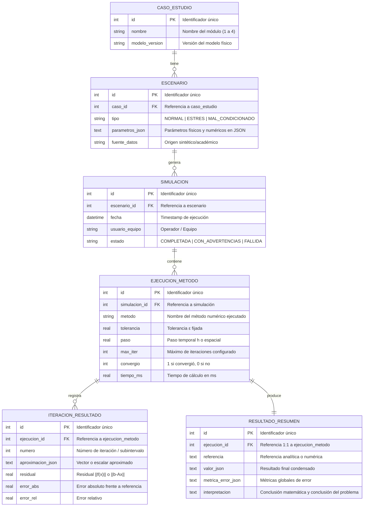

# Modelo Entidad-Relación (DER) — SIMTELE-RISK Semana 2

Este diagrama describe la arquitectura de persistencia relacional implementada en SQLite con 6 entidades y relaciones íntegras (`ON DELETE CASCADE`), requerida para la Semana 2.

## Cumplimiento de la consigna de Base de Datos
- **6 tablas requeridas:** `caso_estudio`, `escenario`, `simulacion`, `ejecucion_metodo`, `iteracion_resultado`, `resultado_resumen`.
- **Integridad referencial activa:** Llaves foráneas con eliminación en cascada (`PRAGMA foreign_keys = ON;`).
- **Prueba de tolerancia (1e-9):** Guarda una simulación completa, reinicia la app, recupera parámetros e iteraciones, repite el cálculo y demuestra coincidencia estricta.
