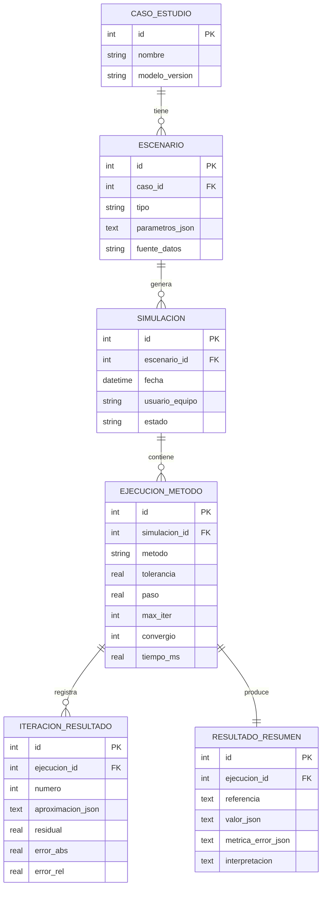

Aquí tienes la base completa de persistencia usando **Bun** (`Bun.serve` + `bun:sqlite` nativo, sin instalar paquetes externos) junto con el modelo relacional, el script SQL con las 6 tablas exactas de la consigna y el cliente frontend para conectarlo directo a tu proyecto actual.

---

### 1. Modelo Entidad-Relación (DER) y Relacional

Guarda este diagrama en `docs/bd/der.md` para tu documentación y defensa:



---

### 2. Script SQL (`db/schema.sql`)

Cumple exactamente con las 6 entidades requeridas, restricciones de integridad referencial (`ON DELETE CASCADE`) y precarga los 4 casos de estudio:

```sql
PRAGMA foreign_keys = ON;

CREATE TABLE IF NOT EXISTS caso_estudio (
    id INTEGER PRIMARY KEY AUTOINCREMENT,
    nombre TEXT NOT NULL UNIQUE,
    modelo_version TEXT NOT NULL DEFAULT 'v2.0-s2'
);

CREATE TABLE IF NOT EXISTS escenario (
    id INTEGER PRIMARY KEY AUTOINCREMENT,
    caso_id INTEGER NOT NULL,
    tipo TEXT NOT NULL CHECK (tipo IN ('NORMAL', 'ESTRES', 'MAL_CONDICIONADO')),
    parametros_json TEXT NOT NULL,
    fuente_datos TEXT NOT NULL,
    FOREIGN KEY (caso_id) REFERENCES caso_estudio(id) ON DELETE CASCADE
);

CREATE TABLE IF NOT EXISTS simulacion (
    id INTEGER PRIMARY KEY AUTOINCREMENT,
    escenario_id INTEGER NOT NULL,
    fecha TEXT NOT NULL DEFAULT (datetime('now', 'localtime')),
    usuario_equipo TEXT DEFAULT 'Estacion-Local',
    estado TEXT NOT NULL CHECK (estado IN ('COMPLETADA', 'CON_ADVERTENCIAS', 'FALLIDA')),
    FOREIGN KEY (escenario_id) REFERENCES escenario(id) ON DELETE CASCADE
);

CREATE TABLE IF NOT EXISTS ejecucion_metodo (
    id INTEGER PRIMARY KEY AUTOINCREMENT,
    simulacion_id INTEGER NOT NULL,
    metodo TEXT NOT NULL,
    tolerancia REAL,
    paso REAL,
    max_iter INTEGER,
    convergio INTEGER NOT NULL CHECK (convergio IN (0, 1)),
    tiempo_ms REAL NOT NULL,
    FOREIGN KEY (simulacion_id) REFERENCES simulacion(id) ON DELETE CASCADE
);

CREATE TABLE IF NOT EXISTS iteracion_resultado (
    id INTEGER PRIMARY KEY AUTOINCREMENT,
    ejecucion_id INTEGER NOT NULL,
    numero INTEGER NOT NULL,
    aproximacion_json TEXT NOT NULL,
    residual REAL,
    error_abs REAL,
    error_rel REAL,
    FOREIGN KEY (ejecucion_id) REFERENCES ejecucion_metodo(id) ON DELETE CASCADE
);

CREATE TABLE IF NOT EXISTS resultado_resumen (
    id INTEGER PRIMARY KEY AUTOINCREMENT,
    ejecucion_id INTEGER NOT NULL UNIQUE,
    referencia TEXT NOT NULL,
    valor_json TEXT NOT NULL,
    metrica_error_json TEXT NOT NULL,
    interpretacion TEXT NOT NULL,
    FOREIGN KEY (ejecucion_id) REFERENCES ejecucion_metodo(id) ON DELETE CASCADE
);

-- Índices para acelerar consultas del historial
CREATE INDEX IF NOT EXISTS idx_simulacion_fecha ON simulacion(fecha DESC);
CREATE INDEX IF NOT EXISTS idx_escenario_caso ON escenario(caso_id, tipo);

-- Datos semilla de los 4 módulos oficiales
INSERT OR IGNORE INTO caso_estudio (id, nombre, modelo_version) VALUES
(1, 'Detención de emergencia', 'v2.0'),
(2, 'Deterioro mecánico', 'v2.0'),
(3, 'Oscilaciones por viento', 'v2.0'),
(4, 'Reconstrucción de sensores', 'v2.0');

```

---

### 3. Servidor Backend + API REST (`server.js`)

Este archivo sirve tu carpeta `public/` (donde pondrás tu `index.html`, `estilos.css` y `principal.js` actuales) y expone la API transaccional de persistencia:

```javascript
import { Database } from "bun:sqlite";
import { readFileSync, mkdirSync } from "node:fs";
import { join } from "node:path";

// Inicializar carpeta y base de datos
mkdirSync("db", { recursive: true });
const db = new Database("db/simtele.db", { create: true });
const schema = readFileSync("db/schema.sql", "utf-8");
db.exec(schema);

// Transacción atómica para guardar una simulación completa
const guardarSimulacionTx = db.transaction((payload) => {
  const { caso_id, tipo_escenario, parametros, fuente_datos, usuario_equipo, estado, ejecuciones } = payload;

  // 1. Insertar escenario
  const resEsc = db.prepare(`
    INSERT INTO escenario (caso_id, tipo, parametros_json, fuente_datos)
    VALUES (?, ?, ?, ?)
  `).run(caso_id, tipo_escenario, JSON.stringify(parametros), fuente_datos || "Sintético / Parámetros supuestos");

  // 2. Insertar simulación
  const resSim = db.prepare(`
    INSERT INTO simulacion (escenario_id, usuario_equipo, estado)
    VALUES (?, ?, ?)
  `).run(resEsc.lastInsertRowid, usuario_equipo || "Equipo-SIMTELE", estado || "COMPLETADA");

  const simulacionId = resSim.lastInsertRowid;

  const stmtEjec = db.prepare(`
    INSERT INTO ejecucion_metodo (simulacion_id, metodo, tolerancia, paso, max_iter, convergio, tiempo_ms)
    VALUES (?, ?, ?, ?, ?, ?, ?)
  `);
  const stmtIter = db.prepare(`
    INSERT INTO iteracion_resultado (ejecucion_id, numero, aproximacion_json, residual, error_abs, error_rel)
    VALUES (?, ?, ?, ?, ?, ?)
  `);
  const stmtRes = db.prepare(`
    INSERT INTO resultado_resumen (ejecucion_id, referencia, valor_json, metrica_error_json, interpretacion)
    VALUES (?, ?, ?, ?, ?)
  `);

  // 3. Insertar métodos, sus iteraciones y su resumen
  for (const ej of ejecuciones) {
    const infoEj = stmtEjec.run(
      simulacionId,
      ej.metodo,
      ej.tolerancia ?? null,
      ej.paso ?? null,
      ej.max_iter ?? null,
      ej.convergio ? 1 : 0,
      ej.tiempo_ms ?? 0
    );
    const ejecucionId = infoEj.lastInsertRowid;

    if (Array.isArray(ej.iteraciones)) {
      for (const it of ej.iteraciones) {
        stmtIter.run(
          ejecucionId,
          it.numero,
          JSON.stringify(it.aproximacion),
          it.residual ?? null,
          it.error_abs ?? null,
          it.error_rel ?? null
        );
      }
    }

    stmtRes.run(
      ejecucionId,
      ej.resumen.referencia,
      JSON.stringify(ej.resumen.valor),
      JSON.stringify(ej.resumen.metrica_error),
      JSON.stringify(ej.resumen.interpretacion) // Contiene { matematica, problema }
    );
  }

  return simulacionId;
});

Bun.serve({
  port: 3000,
  async fetch(req) {
    const url = new URL(req.url);

    // API: Listar historial de simulaciones
    if (url.pathname === "/api/simulaciones" && req.method === "GET") {
      const casoId = url.searchParams.get("caso_id");
      const tipo = url.searchParams.get("tipo");

      let query = `
        SELECT s.id, s.fecha, s.usuario_equipo, s.estado,
               e.tipo AS escenario_tipo, e.parametros_json,
               c.id AS caso_id, c.nombre AS caso_nombre
        FROM simulacion s
        JOIN escenario e ON s.escenario_id = e.id
        JOIN caso_estudio c ON e.caso_id = c.id
        WHERE 1=1
      `;
      const params = [];
      if (casoId) { query += " AND c.id = ?"; params.push(Number(casoId)); }
      if (tipo)   { query += " AND e.tipo = ?"; params.push(tipo); }
      query += " ORDER BY s.id DESC LIMIT 100";

      const rows = db.prepare(query).all(...params);
      return Response.json(rows);
    }

    // API: Guardar nueva simulación
    if (url.pathname === "/api/simulaciones" && req.method === "POST") {
      try {
        const body = await req.json();
        const id = guardarSimulacionTx(body);
        return Response.json({ ok: true, simulacion_id: Number(id) }, { status: 201 });
      } catch (err) {
        return Response.json({ ok: false, error: err.message }, { status: 400 });
      }
    }

    // API: Recuperar detalle completo de una simulación por ID
    const matchDetalle = url.pathname.match(/^\/api\/simulaciones\/(\d+)$/);
    if (matchDetalle && req.method === "GET") {
      const simId = Number(matchDetalle[1]);
      const sim = db.prepare(`
        SELECT s.*, e.caso_id, e.tipo AS escenario_tipo, e.parametros_json, e.fuente_datos, c.nombre AS caso_nombre
        FROM simulacion s
        JOIN escenario e ON s.escenario_id = e.id
        JOIN caso_estudio c ON e.caso_id = c.id
        WHERE s.id = ?
      `).get(simId);

      if (!sim) return Response.json({ error: "Simulación no encontrada" }, { status: 404 });

      const ejecuciones = db.prepare(`SELECT * FROM ejecucion_metodo WHERE simulacion_id = ?`).all(simId);

      for (const ej of ejecuciones) {
        ej.iteraciones = db.prepare(`
          SELECT numero, aproximacion_json, residual, error_abs, error_rel
          FROM iteracion_resultado WHERE ejecucion_id = ? ORDER BY numero ASC
        `).all(ej.id).map(r => ({ ...r, aproximacion: JSON.parse(r.aproximacion_json) }));

        const res = db.prepare(`SELECT * FROM resultado_resumen WHERE ejecucion_id = ?`).get(ej.id);
        ej.resumen = res ? {
          referencia: res.referencia,
          valor: JSON.parse(res.valor_json),
          metrica_error: JSON.parse(res.metrica_error_json),
          interpretacion: JSON.parse(res.interpretacion)
        } : null;
      }

      sim.parametros = JSON.parse(sim.parametros_json);
      return Response.json({ ...sim, ejecuciones });
    }

    // Servir archivos estáticos desde ./public
    let filePath = url.pathname === "/" ? "/index.html" : url.pathname;
    const file = Bun.file(join("public", filePath));
    if (await file.exists()) {
      return new Response(file);
    }
    return new Response("Recurso no encontrado", { status: 404 });
  }
});

console.log("SIMTELE-RISK corriendo en http://localhost:3000");

```

---

### 4. Conector Frontend (`public/js/persistencia.js`)

Incluye este módulo en tu `index.html` para conectar los botones **"Guardar en Historial"**, **"Cargar Simulación"** y **"Relanzar y Verificar Tolerancia"** (la prueba obligatoria de la Semana 2):

```javascript
export const PersistenciaAPI = {
  async guardarSimulacion(payload) {
    const res = await fetch("/api/simulaciones", {
      method: "POST",
      headers: { "Content-Type": "application/json" },
      body: JSON.stringify(payload)
    });
    if (!res.ok) throw new Error(await res.text());
    return await res.json();
  },

  async listarHistorial(filtros = {}) {
    const params = new URLSearchParams();
    if (filtros.caso_id) params.set("caso_id", filtros.caso_id);
    if (filtros.tipo) params.set("tipo", filtros.tipo);
    const res = await fetch(`/api/simulaciones?${params.toString()}`);
    return await res.json();
  },

  async obtenerSimulacion(id) {
    const res = await fetch(`/api/simulaciones/${id}`);
    if (!res.ok) throw new Error("No se pudo recuperar la simulación");
    return await res.json();
  },

  // Prueba de reproducibilidad exigida en la rúbrica
  verificarCoincidencia(valorGuardado, valorRecalculado, tolerancia = 1e-9) {
    const diff = Math.abs(Number(valorGuardado) - Number(valorRecalculado));
    return {
      coincide: diff <= tolerancia,
      diferencia: diff,
      tolerancia
    };
  }
};

```

---

### Cómo probarlo ahora mismo

1. Crea las carpetas `db/` y `public/` en la raíz de tu proyecto.
2. Mueve `index.html`, `estilos.css` y `principal.js` dentro de `public/`.


3. Ejecuta `bun run server.js` en tu terminal.
